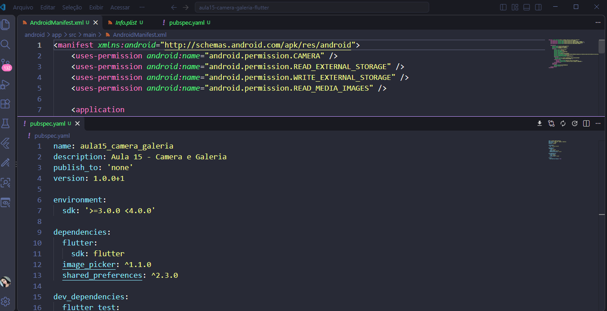
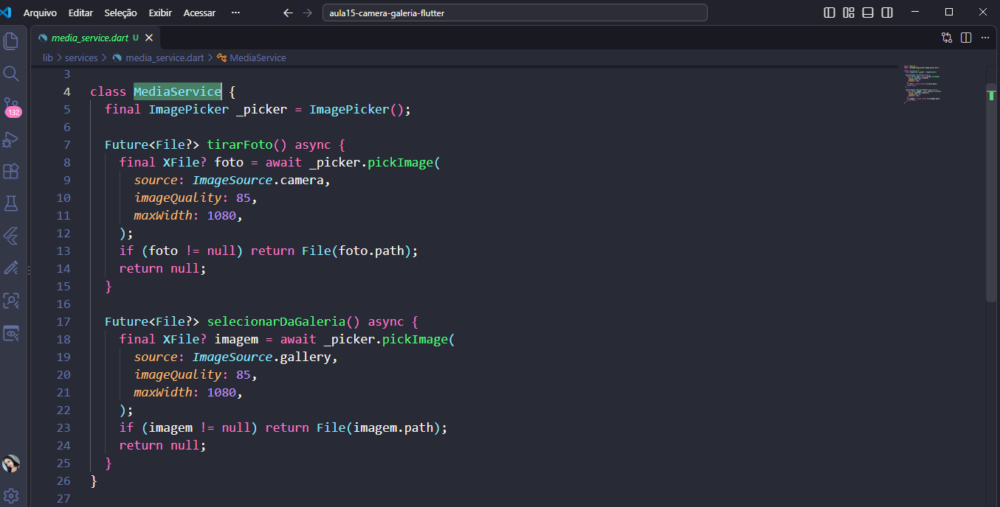
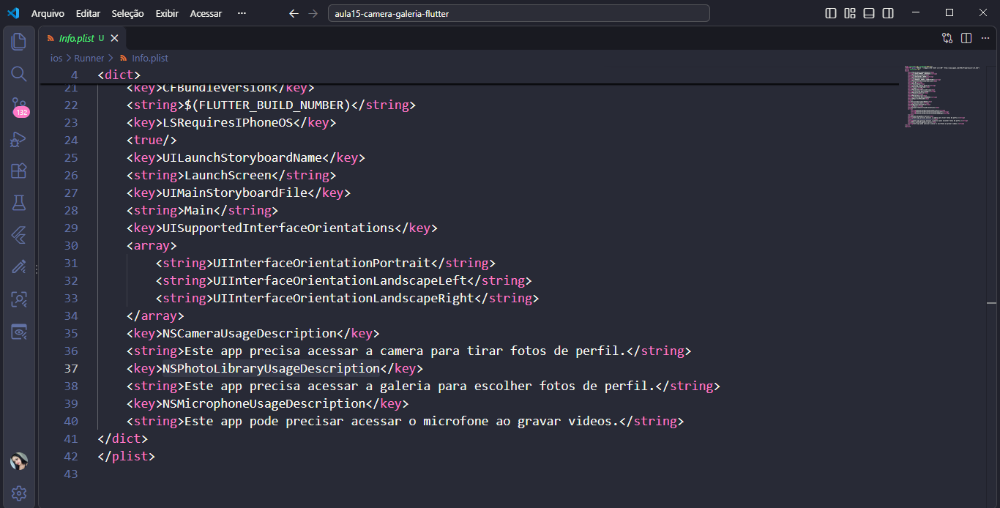
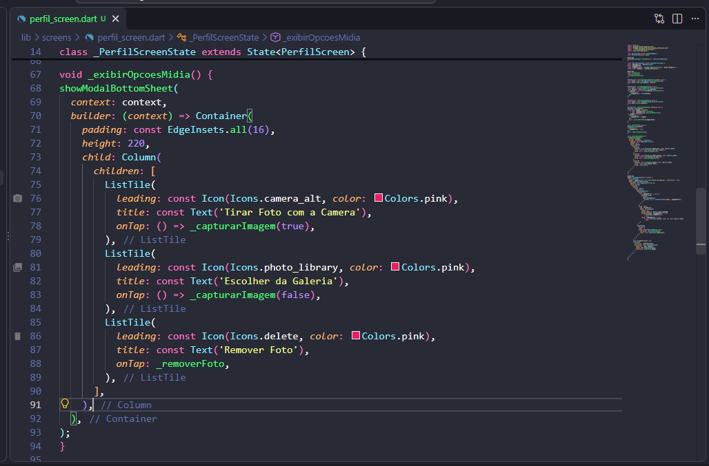
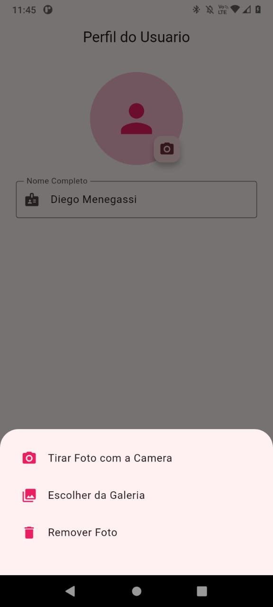

# Aula 15 - Câmera e Galeria de Mídia (Flutter)

Projeto desenvolvido para a disciplina de **Programação para Dispositivos Móveis I**

---

## 📱 Sobre o Projeto

Aplicativo Flutter que implementa a captura de fotos e seleção de imagens da galeria para um perfil de usuário, utilizando o pacote `image_picker`.

### ✨ Funcionalidades Implementadas:
- Captura de foto pela câmera nativa.
- Seleção de imagem da galeria de fotos.
- Exibição da imagem no `CircleAvatar` com `Image.file()`.
- Avatar padrão com ícone quando nenhuma foto é selecionada.
- **Desafio Básico:** Opção de remover a foto atual e redefinir para o avatar padrão.

---

## 🛠️ Tecnologias e Pacotes
- [Flutter](https://flutter.dev/)
- [image_picker](https://pub.dev/packages/image_picker)

---

## ⚙️ Configuração de Permissões

O projeto inclui as permissões necessárias para Android e iOS:
- **Android:** `CAMERA`, `READ_EXTERNAL_STORAGE`, `READ_MEDIA_IMAGES` no `AndroidManifest.xml`.
- **iOS:** `NSCameraUsageDescription` e `NSPhotoLibraryUsageDescription` no `Info.plist`.

---

## 📸 Capturas de Tela

Abaixo estão as evidências do funcionamento e da estrutura do projeto:

| Configuração de Mídia | Camada de Serviço |
| :---: | :---: |
|  |  |
| **Permissões iOS** | **Interface do Código** |
|  |  |

 

| App Rodando (Foto) | Desafio Básico (Remover) |
| :---: | :---: |
|  |  |

 

**Histórico de Commits (Git):**

---

## 🚀 Como executar o projeto

1. Clone este repositório.
2. No terminal, execute `flutter pub get` para baixar as dependências.
3. Conecte um dispositivo físico ou emulador e execute `flutter run`.

---
